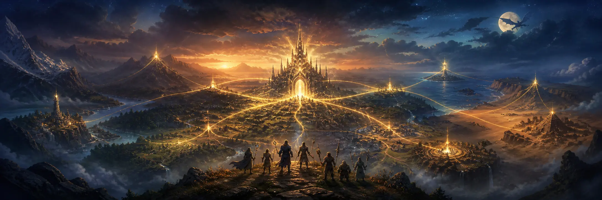
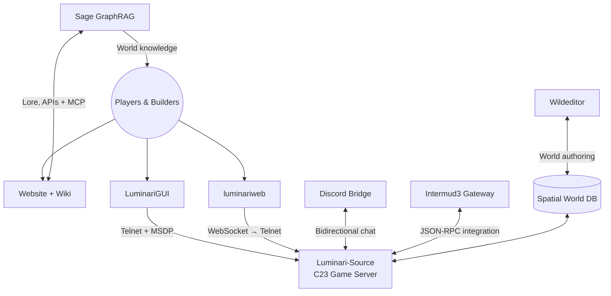

  

<h1 align="center">⚔️ LuminariMUD ⚔️</h1>

  <strong>A living Pathfinder / D&amp;D 3.5 text world—and the engineering ecosystem behind it.</strong>

  <em>Enter a persistent realm. Explore its lore. Help build what comes next.</em>

  
  
  

  
  
  
  
  

---

## Welcome to the LumiVerse

**LuminariMUD** is a persistent, text-based multiplayer RPG built on the tbaMUD/CircleMUD tradition and powered by a modern **GNU C23** server. Its deep rules engine brings **Pathfinder** and **D&amp;D 3.5** mechanics into a shared world of exploration, combat, storytelling, crafting, building, and community.

But the game server is only the heart of the story.

The **LumiVerse** is a connected, multi-product software ecosystem: native and browser clients, real-time protocols, cross-world and Discord gateways, spatial world-building tools, graph-powered lore intelligence, and a full community website and wiki—all maintained by a very small volunteer team.

> **Small team. Vast undertaking.** In commercial terms, the LumiVerse resembles a substantial mid-sized product ecosystem: not mega-company scale, but unquestionably serious engineering and operations.

## Eight systems. One world.

| System | Role in the LumiVerse |
| :--- | :--- |
| 🏰 **[Luminari-Source](https://github.com/LuminariMUD/Luminari-Source)**     | **The realm itself.** A roughly 446,000-line C/header game server with more than 16,000 commits, Pathfinder and D&amp;D 3.5 systems, persistent world data, builders' tools, MariaDB-backed services, and decades of history. |
| 🧭 **[LuminariGUI](https://github.com/LuminariMUD/LuminariGUI)**     | **The adventurer's cockpit.** A rich Mudlet interface with live MSDP vitals, interactive mapping, tabbed chat, spell and affect tracking, group status, sound alerts, and a customizable layout. |
| 🌐 **[luminariweb](https://github.com/LuminariMUD/luminariweb)**     | **The browser gateway.** A first-party React client with an MSDP-driven HUD, accessible terminal experience, PWA capabilities, and a secure WebSocket-to-Telnet proxy. **[Launch it →](https://web.luminarimud.com/)** |
| 🔮 **[Intermud3](https://github.com/LuminariMUD/Intermud3)**     | **The road between worlds.** An independent Python I3 gateway with MudMode/LPC framing, router state, network services, observability, and JSON-RPC APIs integrated directly with the C server. |
| 💬 **[discord-mud-chat](https://github.com/LuminariMUD/discord-mud-chat)**     | **The community bridge.** Bidirectional MUD ↔ Discord chat with channel mapping, reconnects, rate limiting, mention safety, logging, health checks, and container-ready operations. |
| 🗺️ **[wildeditor](https://github.com/LuminariMUD/wildeditor)**     | **The cartographer's workshop.** A full-stack wilderness editor for drawing regions and paths against the game's spatial database, with strict shared types, validation, authentication boundaries, REST APIs, MCP tools, and an optional AI assistant. |
| 📚 **[Sage](https://github.com/LuminariMUD/sage)**     | **The living library.** A production-oriented GraphRAG lore platform combining PostgreSQL/pgvector, Neo4j, knowledge graphs, validation workflows, APIs, agents, and MCP to make the world's canon discoverable. |
| ✨ **Website &amp; community tooling** *(private)*    | **The front door.** The full Astro-powered [LuminariMUD.com](https://luminarimud.com/) experience, wiki, project presentation, and community-facing services. |

## How the realm fits together

## The technology spellbook

  
  
  
  
  
  

  
  
  
  
  
  
  
  

## Choose your doorway

| ⚔️ **Play** | 🧭 **Adventure with Mudlet** | 🛠️ **Build** |
| :---: | :---: | :---: |
| Jump straight into the [browser client](https://web.luminarimud.com/), or begin at [LuminariMUD.com](https://luminarimud.com/). | Install [LuminariGUI](https://github.com/LuminariMUD/LuminariGUI) for mapping, live gauges, chat tabs, spell tracking, and more. | Start with the server's [onboarding checklist](https://github.com/LuminariMUD/Luminari-Source/blob/master/docs/onboarding.md), then choose the layer that calls to you. |

## Join the party

The LumiVerse has room for **C hackers, world builders, frontend engineers, Python developers, lorekeepers, testers, technical writers, artists, operators, and curious players**.

- 🗡️ **Find your quest:** browse the [open issues across the organization](https://github.com/search?q=org%3ALuminariMUD+is%3Aissue+is%3Aopen&type=issues).
- 📜 **Read the map:** every public project keeps its own setup, architecture, testing, and contribution guidance close to the code.
- 🏗️ **Build the world:** begin with [Luminari-Source](https://github.com/LuminariMUD/Luminari-Source), [Wildeditor](https://github.com/LuminariMUD/wildeditor), or the [builder quickstart](https://github.com/LuminariMUD/Luminari-Source/blob/master/docs/world_game-data/BUILDER_QUICKSTART.md).
- 🔭 **Explore the whole ecosystem:** visit the [LuminariMUD repositories](https://github.com/orgs/LuminariMUD/repositories).

---

  <strong>One persistent world · Eight connected systems · Countless stories still unwritten</strong>

  <a href="https://luminarimud.com/">Website</a> ·
  <a href="https://web.luminarimud.com/">Play in Browser</a> ·
  <a href="https://github.com/LuminariMUD/Luminari-Source">Game Server</a> ·
  <a href="https://github.com/orgs/LuminariMUD/repositories">All Repositories</a>

